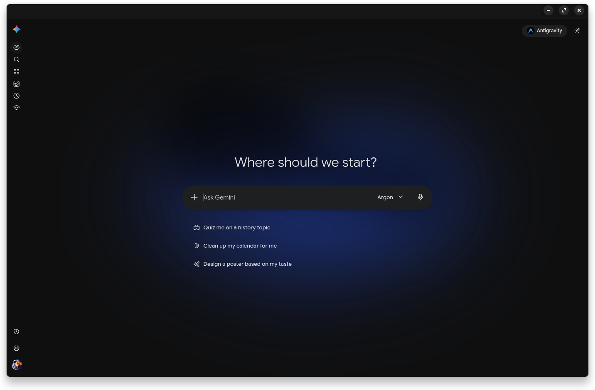

<p align="center">
  
  &nbsp;&nbsp;
  
</p>

# 🧩 Antigravity Plugin

[](CHANGELOG.md)
[](https://github.com/Riccardo-Vecchi/antigravity-plugin/actions/workflows/checks.yml)
[](docs/CONFIGURATION.md)
[](windows/README.md)
[](NOTICE.md)
[](LICENSE)

**Unofficial plugin** for the Google Antigravity app on **Linux and Windows**. Requires the official Antigravity app to be installed separately.

> [!NOTE]
> Independent project, not affiliated with or endorsed by Google. Antigravity and Gemini names and logos belong to Google. See [NOTICE](NOTICE.md).

## 🖥️ Platforms

| Platform | Status |
| --- | --- |
| 🐧 Linux x86-64 | Verified with Antigravity App 2.28.0 on Zorin/GNOME 46 |
|  Windows 11 x64 | **Experimental**; community-verified installation on 2.28.0; desktop automation validation is pending |

## ✨ Features

- Gemini in the same window, with an in-page return button and a configurable shortcut (default **Ctrl+Alt+G**).
- Optional **Computer Use** with guided setup for the whole desktop or selected apps. [Setup guide](docs/COMPUTER_USE.md).
- **Browser use** with browser detection, one-click folder copy/open, selected tabs or whole-profile web-tab sharing and existing logins. [Setup](docs/BROWSER_USE.md).
- Separate model and reasoning-effort controls with a stepped slider and per-model memory, plus favorites, visibility controls and provider logos. Permissions sit on the left; model and effort sit on the right.
- Project icons, emoji and colors through **Project ⋯ → Edit**, shared across the sidebar and project selector.
- Expanded, compact or **Expand on hover** sidebar modes; the compact view keeps navigation and project icons visible.
- Fixed Antigravity/Gemini icons or a Dynamic mode, including supported tray integrations.
- Startup view, Remember last view, desktop autostart, and patch status/recovery controls.
- Optional **Library** for generated files and uploads, with search, favorites and local document, media and 3D previews. [Details](docs/LIBRARY.md).

## 📸 Screenshots

<table width="100%">
  <tr>
    <th width="50%">A better and more colorful Antigravity</th>
    <th width="50%">Gemini in the same window</th>
  </tr>
  <tr>
    <td width="50%" align="center" valign="middle"></td>
    <td width="50%" align="center" valign="middle"></td>
  </tr>
  <tr>
    <th width="50%">Application and tray icons</th>
    <th width="50%">Startup and autostart</th>
  </tr>
  <tr>
    <td width="50%" align="center" valign="middle"></td>
    <td width="50%" align="center" valign="middle"></td>
  </tr>
  <tr>
    <th width="50%">Library of generated artifacts</th>
    <th width="50%">Computer use</th>
  </tr>
  <tr>
    <td width="50%" align="center" valign="middle"></td>
    <td width="50%" align="center" valign="middle"></td>
  </tr>
</table>

## 🐧 Install on Linux

Install the **latest official** [Antigravity AppImage](https://antigravity.google/download) and **Node.js 22+** first. Standard GNOME/Zorin desktop components are also used; see the [Linux requirements](linux/README.md#tested-linux-setup) for other distributions.

```bash
git clone https://github.com/Riccardo-Vecchi/antigravity-plugin.git
cd antigravity-plugin
./linux/install.sh
```

Open Antigravity normally. The helper runs as a user service. The AppImage and launcher are detected automatically. Ambiguous installations require an explicit selection; see the [Linux reference](linux/README.md#install-on-linux).

##  Install on Windows

Install the **latest official** [Antigravity app for Windows x64](https://antigravity.google/download) first. The companion uses Windows PowerShell 5.1+ and the app's bundled runtime; no separate Node.js installation or administrator privileges are required.

Download this repository with **Code → Download ZIP**, extract it, and open PowerShell in the extracted folder. Then run:

```powershell
powershell.exe -NoProfile -ExecutionPolicy Bypass -File .\windows\install.ps1 -Launch
```

Open **Antigravity (customized)** from the Start menu for subsequent launches. The execution-policy option applies only to that invocation. See the [Windows guide](windows/README.md) for custom app paths, integration details, and the exact validation limits.

## ⚙️ Settings and updates

**Computer use:** open **Settings → Computer use** and enable it. Reuses saved access, or starts with **Entire desktop** on first setup; choose **Selected apps** to limit access. When disabled, only its activation controls remain visible. Works with the native Antigravity agent. On GNOME/Wayland, first setup may require a Linux logout/login. [Setup and troubleshooting](docs/COMPUTER_USE.md).

**Browser use:** open **Settings → Browser use** and enable its switch. When disabled, only activation controls remain visible. **Open [browser] Extensions** opens the selected browser’s Extensions page for installation or Reload. Releases also include an [extension ZIP](https://github.com/Riccardo-Vecchi/antigravity-plugin/releases/latest/download/antigravity-browser.zip); browser installation approval is still required. [Packaging and installation limits](docs/BROWSER_USE.md#-packaged-extension-and-installation-approval).

**Shortcuts** lets you record, save, reset or disable the view-switch shortcut. **Appearance** contains app-icon choices; **Application → Startup** contains launch behavior; **Application → Plugin updates → Plugin customizations** contains status and recovery.

**Appearance → Sidebar** selects Expanded, Compact or Expand on hover. **Appearance → Library → Enable Library** shows or hides the library while preserving favorites and added files.

**Enable/disable:** use **Application → Plugin updates → Enable plugin**. Disabling pauses customizations, restores native icons and disconnects desktop/browser access while keeping preferences and Gemini sessions. Re-enable from the same place; tool access is enabled separately. The small management helper and desktop startup choices remain available.

**Plugin updates:** after installing this version once, the plugin checks stable GitHub releases every 24 hours and installs verified updates automatically when its settings/editors are closed. **Antigravity → Check Plugin Updates** or **Application → Plugin updates → Check Plugin Updates** forces an immediate check; you can disable automatic installation or install an available release manually. Local previews and modified plugin files are protected from automatic replacement. See the [update reference](docs/UPDATES.md).

To stop the helper entirely instead:

- **🐧 Linux:** run `./linux/disable.sh` from the repository. Save any Gemini draft first.
- ** Windows:** run the command in [Update and disable](windows/README.md#update-and-disable).

The official application and conversation databases are not patched. Gemini sign-in stays separate from browser profiles. Detailed settings, session behavior, data locations and Linux recovery are in the [reference](docs/CONFIGURATION.md).

## 🛠️ Development

`common/` contains the shared runtime and UI; `linux/` and `windows/` contain platform adapters and scripts. `common/distribution.json` defines deployment files; stable installed icon paths and older Windows shortcuts remain compatible. Run `node --test tests/*.test.cjs`; CI also checks script syntax. Preview libraries are bundled offline: maintainers use `npm ci --ignore-scripts` and `npm run build:viewers` to reproduce them; users do not need npm. Python 3 is used only to build/test the standalone extension ZIP (`python3 -m unittest discover -s tests -p 'test_*.py'`). See [privacy notes](docs/PRIVACY.md) for published-data boundaries.

## 📜 License

The original integration code is licensed under [0BSD](LICENSE): use, modify, fork and redistribute it, including commercially, without an attribution requirement. Google branding is excluded; see [NOTICE](NOTICE.md).
