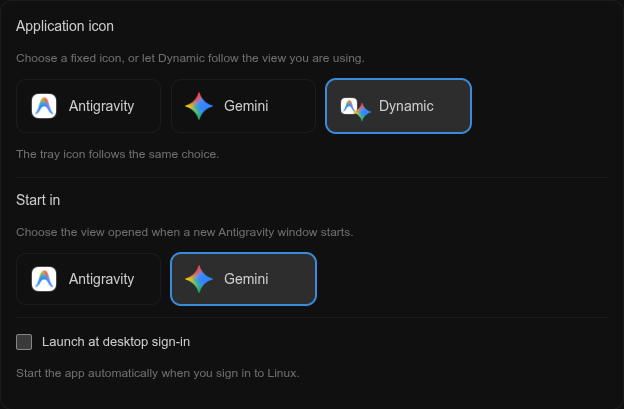
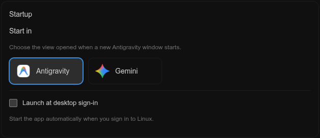
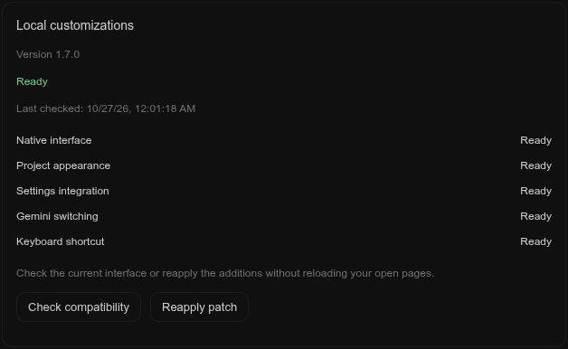

<p align="center">
  
  &nbsp;&nbsp;
  
</p>

# Antigravity Customizations for Linux and Windows

Unofficial Linux and Windows additions for Google Antigravity: project icons and colors, a compact sidebar, Gemini in the same window, configurable application icons, startup view, and desktop autostart.

**This is an independent project. It is not affiliated with, endorsed by, or supported by Google. Antigravity and Gemini names, logos, and other Google branding belong to Google.** The official AppImage and signed Windows application remain unchanged.

## Features

| Feature | Behavior |
| --- | --- |
| Project appearance | **⋯ → Edit** opens an icon/emoji picker with colors, custom hex values, and icon search. Preferences follow the project ID. |
| Consistent project icons | The sidebar, project selector, and selected project share the same appearance. |
| Compact sidebar | Collapsing the sidebar leaves a narrow rail with navigation, project icons, and Settings. |
| Gemini in the same window | Open the official `gemini.google.com` website with the **Gemini** button. **Antigravity**, next to Temporary chat, returns to the native app. |
| Cleaner Gemini view | The extra URL/navigation toolbar is hidden. Antigravity menu labels disappear in Gemini and return in the native view. Window controls remain available. |
| Fixed or dynamic app icon | Choose **Antigravity**, **Gemini**, or **Dynamic**. Dynamic follows the view most recently used in an app window. |
| Native tray icon | The tray follows the same icon choice on supported Zorin/GNOME AppIndicator setups and the Windows customized launcher; the native tray menu is retained. |
| Startup view | Open new windows in Antigravity, Gemini, or the last view used. Changing this setting does not navigate an existing window. |
| View shortcut | **Ctrl+Alt+G** switches between Antigravity and Gemini while the app is focused. |
| Patch status and recovery | See the installed patch version, check the current interface, and reapply the additions without reloading open pages. |
| Desktop autostart | Enable or disable **Launch at desktop sign-in**, backed by an XDG autostart entry on Linux or an owned current-user Startup shortcut on Windows. |
| Localized additions | English, Italian, German, Spanish, French, Simplified Chinese, and Japanese; unsupported languages fall back to English. |







## Platforms

| Platform | Status | Installation |
| --- | --- | --- |
| Linux x86-64 | Verified on the Zorin/GNOME setup below | AppImage instructions below |
| Windows 11 x64 | **Experimental; desktop integration not yet verified end to end** | [Windows companion and validation](WINDOWS.md) |

On Windows, use the separate **Antigravity (customized)** launcher; no external Node.js installation is required. Automated Windows adapter tests run on Linux and do not substitute for testing the actual Windows desktop.

The repository name is retained for existing users. The project appearance and Gemini interface code are shared; desktop, tray, and autostart integration use each platform's own implementation.

## Tested Linux setup

- Antigravity App **2.26.0**, official Linux x86-64 AppImage.
- Zorin OS with **GNOME Shell 46**, Wayland, Zorin taskbar, and Zorin AppIndicator.
- Node.js **22+**, with built-in `fetch` and `WebSocket`.
- Python 3 with PyGObject/Gio, a user systemd session, `update-desktop-database`, and `gtk-update-icon-cache`.

The integration uses the app's existing local debugging endpoint. Other app versions, packaging formats, desktop environments, and future Google UI changes may require adjustments. Tray customization is detected at runtime and is optional; it is not claimed to work on every Linux tray implementation.

## Install on Linux

Install the official Antigravity AppImage first. The current defaults are:

```text
~/.local/opt/Antigravity.AppImage
~/.local/share/applications/alacarte-made.desktop
```

The launcher must invoke that AppImage directly. If your paths differ, configure `AGPA_APPIMAGE` and `AGPA_DESKTOP_FILE` in the user service before using the application-icon controls. These paths are validated before the launcher is modified.

```bash
gh repo clone Riccardo-Vecchi/antigravity-linux-customizations
cd antigravity-linux-customizations
./install.sh
```

The installer uses the current `node` executable and creates a user service. No root privileges or npm dependencies are required. Keep the selected Node.js runtime available.

```bash
systemctl --user status antigravity-project-appearance.service
journalctl --user -u antigravity-project-appearance.service -n 30 --no-pager
```

Open Antigravity normally. The helper waits when the app is closed and reapplies the UI additions to new windows.

## Settings

Open **Settings → Appearance** for visual options:

- **Application icon:** fixed Antigravity, fixed Gemini, or Dynamic.

Open **Settings → Application → Startup** for launch behavior:

- **Start in:** Antigravity, Gemini, or **Remember last view**. The last view is shared across app windows and survives helper/app restarts. With no saved view, Antigravity is used.
- **Launch at desktop sign-in:** whether the desktop should launch the app after you sign in.

These choices are independent. For example, you can start in Gemini, use a fixed Antigravity icon, and keep autostart disabled.

On Linux, the helper service starting with your session does **not** itself launch Antigravity. The separate autostart checkbox creates/removes its own launcher in `~/.config/autostart/`. Desktop policy or separate startup entries created outside this project can affect autostart behavior. See the [XDG autostart specification](https://specifications.freedesktop.org/autostart/latest/).

In Dynamic mode, the taskbar and supported tray follow the last view reported by an app window. The icon is global to the app; multiple windows do not have separate taskbar identities.

Open **Settings → Shortcuts** for **Ctrl+Alt+G**, the window-local switch between Antigravity and Gemini. It does not register an operating-system-wide shortcut, and repeated keys, input-method composition, and AltGr typing are ignored. The in-page shortcut is added only on the official Gemini origin; account sign-in pages retain the visible return button.

## Patch status and recovery

Open **Settings → Application → Local customizations**:

- **Version** identifies the installed helper code.
- **Check compatibility** reads the current native interface hooks and checks the project, settings, Gemini, and keyboard integrations. The result and time of the last check are shown for that window.
- **Reapply patch** restores the integration's controls and styles without navigating the native app or the Gemini guest. Project customizations and app preferences are retained.

Checks distinguish missing helper elements (repairable) from missing native hooks (incompatible). Reapplication is skipped if required native hooks changed, a project editor is open, or an existing Gemini guest lost its original controller. This preserves the current session; a changed upstream interface can require a source update followed by `./install.sh`.

These are local interface checks. A Ready result does not certify every vendor feature, website request, login flow, or future app release. Reapplication repairs the running UI; it does not download updates, overwrite the AppImage, or change your desktop settings.

## Languages

The additions follow the native page's declared interface language (`<html lang>`), including changes while the app is open. If the page declares no language, Chromium's preferred language is used. Regional variants map to their base language, and unsupported languages fall back to English.

Translations cover settings, project editing, the compact sidebar, accessibility labels, tooltips, status/error messages, and the Antigravity return button in Gemini. Icon names can be searched in the selected language; stable icon IDs remain unchanged. Changing language preserves open inputs and unsaved project appearance choices. Project names, user text, and Google's website content are not translated by this helper.

The tested Antigravity 2.26.0 interface declares English and does not expose a native display-language selector in its settings. This integration does not add a separate language preference or translate the native app. Live language checks change the native document's language temporarily, then restore it; following an upstream language preference depends on the app declaring that language.

## Gemini sessions and switching

Gemini runs in an isolated persistent webview session. Returning to Antigravity keeps that guest mounted, preserving the page and unsent draft. The native app stays mounted as well.

Sign in to Google inside the embedded website on first use. Browser cookies and passwords are not imported, and native Antigravity credentials are not reused. Google controls website availability, account checks, and whether embedded sign-in is accepted. A Google prompt may need the normal **Resend** action; this project does not bypass authentication.

Only the return button is added to the Gemini page, in an isolated JavaScript world. The website does not receive Node.js, Antigravity's preload APIs, or the local settings bridge. Web security, context isolation, and sandboxing remain enabled. On Linux, no new debugging port is opened. On Windows, the customized launcher temporarily uses the existing main-process inspector capability on loopback for native icons, then closes it; see the [Windows integration details](WINDOWS.md#native-window-and-tray-icons). The project relies on [Electron's existing webview support](https://www.electronjs.org/docs/latest/api/webview-tag).

## How the Linux live icons work

The launcher keeps its application identity and uses a stable icon file. Compatibility paths and the existing Antigravity icons in the user's hicolor theme are updated as needed. Original images are retained for restoration; Gemini's source assets are separate from the mutable display files.

GNOME can retain an old icon even after files change. To invalidate that cache, the helper briefly selects an empty internal theme inheriting the current icon theme, then restores the original preference. Its recovery record also handles an interrupted refresh, and a concurrent theme change by the user is respected. No shell restart is needed.

Tray support uses the existing Zorin/GNOME AppIndicator `custom-icons` setting for Antigravity's indicator ID. It preserves other indicators and records the previous Antigravity override. It does not replace the native tray process or its menu.

## Linux files and data

```text
~/.local/share/antigravity-project-appearance/       installed code and icon assets
~/.config/antigravity-project-appearance/projects.json
~/.config/antigravity-project-appearance/app.json
~/.config/antigravity-project-appearance/session.json  last view only
~/.config/antigravity-project-appearance/icon-originals/
~/.config/antigravity-project-appearance/asset-originals/
~/.config/antigravity-project-appearance/tray-settings-original.json
~/.config/systemd/user/antigravity-project-appearance.service
~/.config/autostart/antigravity-linux-customizations.desktop  only while enabled
~/.config/Antigravity/Partitions/agpa-gemini/         Chromium-managed Gemini session
```

Project files, conversation databases, and the official AppImage are not patched. The icon selection updates the local launcher and icon assets; autostart updates only this project's marked startup entry.

Preferences and icon backups are local and excluded from this repository. Do not delete the original-icon backups if you want exact restoration.

## Update, disable, restore on Linux

After updating the source:

```bash
./install.sh
```

The installer preserves already-open Antigravity/Gemini documents while restarting the helper. If an app update changes its DOM, preload APIs, debugging endpoint, or packaging, the integration may need an updated patch.

To remove the active integration and restore original desktop/tray icons:

```bash
./disable.sh
```

This disables the helper and this project's desktop autostart entry. Code, preferences, icon backups, and Google's persistent web session remain on disk for later use. Disabling removes the embedded view, so save or send any Gemini draft before doing so.

## Validation

```bash
node --test tests/*.test.cjs
node --check daemon.cjs
bash -n install.sh disable.sh
python3 -m py_compile refresh-icon-theme.py sync-tray-icon.py
```

Automated tests cover preference migration, independent startup/icon choices, one-time/remember-last startup, session-state persistence and recovery, shortcut handling and AltGr, compatibility/recovery gates, translation coverage/placeholders, regional languages, English fallback, and updating open controls without losing input. Live checks cover switching with the shortcut from both the native page and Gemini, recovery after removing a helper stylesheet, refusing recovery when a native hook is missing, helper restarts with the last view preserved, and localized controls in all seven languages. Earlier live checks cover project appearance, compact sidebar, fixed/dynamic icons, tray, menu hiding, and XDG autostart. A full logout/login is deliberately not part of the automated checks.

Windows-specific tests additionally cover path handling, native icon requests, stale-process detection, inspector-closure reporting, existing-tray preservation, and owned-autostart rollback. See [Windows validation](WINDOWS.md#validation-status) for actual VM coverage and remaining boundaries.

This repository contains the integration source and generic tests, not personal diagnostics, account information, cookies, conversations, or feedback submission receipts.

## Branding and attribution

See [NOTICE.md](NOTICE.md) and [asset sources](assets/SOURCES.md). Google owns the Antigravity and Gemini branding. No rights in Google logos or the proprietary application are granted by this repository.
