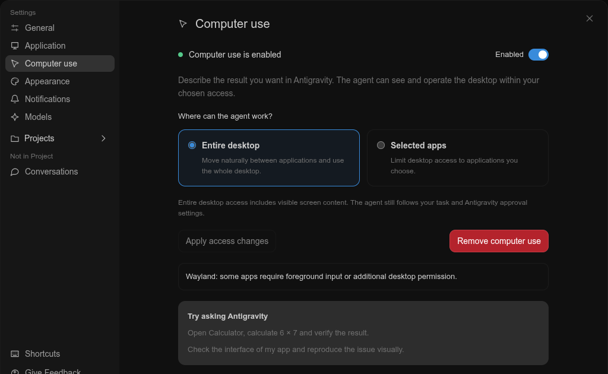
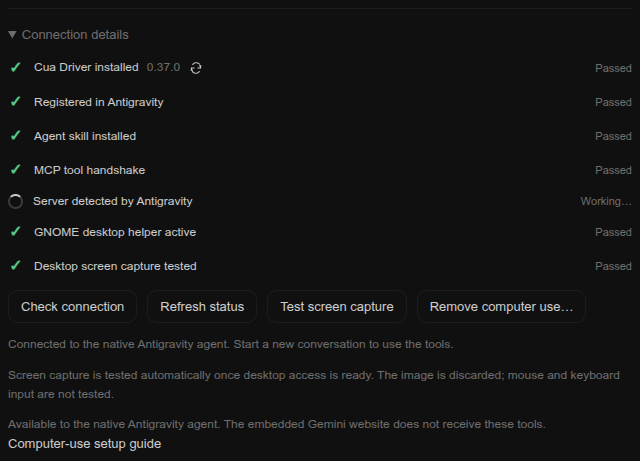
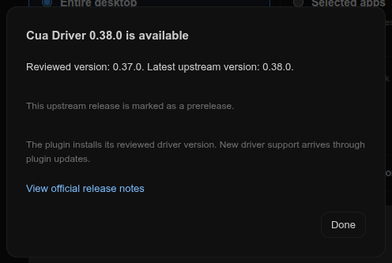

# 🖱️ Computer use

Give the **native Antigravity agent** desktop tools through the maintained [Cua Driver](https://github.com/trycua/cua/tree/main/libs/cua-driver). The agent uses its existing model; the driver needs no separate model API key. The embedded Gemini website remains a separate web session and does not receive these tools.

## 🧭 Get started

1. Open **Settings → Computer use**, its own item in the Settings menu. Settings navigation has icons; its Projects group can be collapsed and uses your configured project appearance.
2. Turn on the **Computer use** switch at the top. Your saved access is reused; first setup starts with **Entire desktop**. After enabling, choose **Selected apps** and apply changes if you prefer an application allowlist.
3. A centered progress dialog shows the active step with a spinner, individual checks, and actual downloaded MB. **Continue in background** or Escape hides the dialog while setup continues; **Cancel setup** revokes it. Setup downloads the reviewed driver, verifies its SHA-256, installs the GNOME helper when needed, writes this integration's MCP entry and skill, checks the protocol and asks Antigravity to refresh only this server.
4. Follow any OS access prompt. On GNOME/Wayland, the helper needs a **Linux session logout/login once** to load. Save your work, open the system menu → Power → Log Out (on Zorin), then sign in to Linux again. Reopen Antigravity and select **Refresh status**. **Locking/unlocking the screen keeps the same Linux session and does not load the extension.** Closing the app or signing out of Google also does not load it. The wizard never logs you out or restarts your apps.
5. Start a **new Antigravity conversation** and describe the result you want. Existing conversations can keep their earlier tool list.

Try: “Open Calculator, calculate 6 × 7 and verify the displayed result.” The agent should observe **42 in the app**, rather than report only a successful tool call.

**Connection details** displays each check on its own line: green checkmark for passed, orange dot for pending. It checks driver installation, MCP registration, the generated agent skill, the protocol handshake, native server detection and the desktop helper. In Entire desktop mode, screen capture is checked **automatically** during setup when access is ready, or once when the page next detects that access has become ready (including after Linux login). A failed attempt stays pending without a polling/retry loop; **Test screen capture** remains available for an explicit retry. The plugin discards the returned image and reports only the result; this does not test mouse or keyboard input. Selected apps never triggers a full-desktop capture, and an MCP handshake alone never marks capture as passed.

If an upstream app change prevents automatic MCP refresh, use native **Customizations → Installed → MCP Servers**, or its Settings equivalent, and refresh/reopen Antigravity when convenient.

## 🔄 Check Cua Driver updates

Use the refresh icon beside the driver version in **Connection details**. It spins during the lookup and opens a dialog with the reviewed and latest upstream versions, release notes, or a connection error. Discovery reads official GitHub releases for `trycua/cua`, matches regular numeric `cua-driver-rs-vX.Y.Z` tags, and excludes other products, drafts, nightly and suffixed preview tags. A numeric release can still carry GitHub’s prerelease flag; the dialog states that explicitly. Successful results are cached for one minute.

This check does not install or execute a newer release. Setup continues to install the SHA-256-pinned reviewed version. New driver support arrives in a plugin update.

## 🖥️ Choose the access that fits

| Mode | Access |
| --- | --- |
| **Entire desktop** | App/window discovery, full-desktop and window observations, mouse movement, click, drag, keyboard and application launch. The driver runs in its normal **standard** permission mode, with its normal protected-target and grant checks. |
| **Selected apps** | Only chosen executable paths and their windows/launch actions. Uses the driver's **bounded** mode with a capability manifest; general app enumeration and full-desktop capture are excluded. The detected-app selector helps add common applications; manual absolute paths remain available. |

Changing scope requires **Apply access changes**. It revokes earlier connections before starting the new scope. Choosing Entire desktop is not an `unrestricted`/bypass-approvals setting. Existing Antigravity approvals remain in force.

In either mode, the bridge exposes only the reviewed GUI tool set (17 tools for Entire desktop and 14 for Selected apps in driver 0.37.0). It excludes direct shell execution, arbitrary scripts, filesystem tools, process termination and browser-profile attachment. GUI interaction can still modify files, accounts and signed-in applications as part of a task; visible contents may be processed by Antigravity's model. These controls limit this driver, not Antigravity's independent shell access or another process running as your user.

## 🎚️ Enable, disable and stop

The top switch reflects the actual connection state. **OFF** revokes desktop access and disconnects the native agent while keeping the installed driver and access choices. **ON** runs setup/reconnection using your saved access choices (Entire desktop on first setup); an installed reviewed driver is reused. **Apply access changes** saves scope edits while enabled.

The switch is the single connection control and remains usable to cancel setup after the progress dialog is sent to the background. The dialog has a contextual **Cancel setup** action. The red **Remove computer use** button removes managed components after confirmation.

**Apply access changes** is gray and disabled when the visible scope/app list matches the saved configuration. Selecting another scope or editing the selected-app allowlist makes it white and clickable; selecting the original scope again disables it. Reordering/duplicating app paths alone is not an access change.

When disabled, only the activation switch and a short summary remain visible. Access choices, removal, diagnostics, version checks and examples are hidden together. Enabling restores the full interface and saved access choices. Setup errors remain visible so a failed activation is never silent.

Activity spinners keep rotating even when the OS requests reduced motion, as an explicit exception limited to these work indicators. Other OS motion preferences are unchanged.

## ⏹️ Disable and cancel

Switching **OFF** cancels setup and revokes the lease and removes only the plugin's MCP entry, preserving unrelated servers. The bridge checks revocation every 300 ms, requests graceful shutdown and forces exit if needed. An action already delivered cannot be undone. Driver files, scope choices and the owned skill remain available for reconnecting.

The platform disable scripts also disconnect computer use. In Selected apps mode, capability sessions expire after eight hours, with a thirty-minute idle timeout; reconnect to start a fresh runtime. Entire desktop uses the normal driver session lifecycle.

## ♻️ Remove and set up again

Open **Settings → Computer use → Remove computer use**, the red button, and confirm in the centered dialog. Cancel or press Escape to keep the setup. This revokes the connection, removes only the plugin's own MCP entry, deletes its verified managed driver, setup preferences and unchanged generated skill. Then turn on the top switch to download and configure it again.

Other MCP servers, conversations, Antigravity/Gemini data, other Cua installations and the **shared WinRects GNOME extension** remain untouched. A locally edited skill is preserved and reported: rename or remove it yourself before a fresh setup. Unrecognized driver folders or missing/invalid receipts stop removal instead of deleting unknown files. Use **Repair desktop helper** for a disabled or failed helper; reinstallation is unnecessary when it only needs the next Linux sign-in.

## 🐧 Linux

The wizard installs the official x86-64 or ARM64 driver asset. An active graphical session and AT-SPI are required; distro dependencies can include `at-spi2-core` and `libxi6`. It does not run `sudo`, change your PATH or install deprecated `cua-agent` or perception/model packages.

GNOME/Mutter Wayland uses the bundled WinRects Shell helper and can require portal consent. Its installer preserves newer shared helper versions and other enabled extensions. Until GNOME loads the helper, the page shows a compact **Desktop access needs activation** notice with explicit Linux logout/login steps. Installed files and an extension actively loaded by GNOME are checked separately. X11, GNOME, KDE and other compositors have different support: background input and occluded windows remain limited. See [upstream platform support](https://cua.ai/docs/cua-driver/concepts/platform-support).

A successful MCP handshake checks the protocol and available tools. It does **not** prove that the OS permits capture/input or that an application task succeeded. The page keeps that distinction visible.

##  Windows (experimental)

The same wizard uses the official Windows x64 ZIP and Antigravity's bundled runtime; no separate Node.js, Python, administrator access or scheduled driver task is required. Extraction includes the driver's UI Automation helper. Launch through **Antigravity (customized)** in the interactive desktop session and keep the target app visible. Elevated apps can refuse input.

Windows is covered by adapter/configuration tests, release archive-layout verification and PowerShell syntax checks. A full Windows GUI task has not been verified for this integration.

## 🔧 Installation, privacy and compatibility

- Reviewed driver: **0.37.0**, pinned to official release asset SHA-256 values. Future plugin releases can update the reviewed pin; setup never silently adopts an unreviewed driver.
- Downloads run no remote installer script. The driver is a separate MIT-licensed upstream dependency, not relicensed under the plugin's 0BSD license. No driver binaries or private configuration are published here. SHA-256 pin verification is not a claim of Sigstore signature verification.
- Plugin-launched driver calls disable telemetry with `CUA_DRIVER_RS_TELEMETRY_ENABLED=0` and `CUA_TELEMETRY_ENABLED=0`. Other Cua installations are unchanged.
- Local files live under the existing plugin configuration directory in `computer-use/`: `state.json`, `capabilities.json`, and `driver-0.37.0/`. They can contain local application paths and must not be shared or committed.
- The wizard merges `~/.gemini/config/mcp_config.json` and installs its owned skill under `~/.gemini/config/skills/antigravity-plugin-computer-use/` (under the user's home on Windows too). Unrelated MCP entries and locally edited skills are preserved. Invalid JSON, symlinks, conflicts or detected concurrent edits stop configuration.
- Automatic native MCP refresh uses a narrowly recognized Antigravity state-provider contract. It refreshes only this server and falls back to manual native refresh if the interface changes.

## ✅ Validation boundaries

Verified live on Linux: the dedicated Settings page, navigation icons, Projects collapse, scoped/full-desktop configuration, native Antigravity discovery of the reviewed tool set, protocol checks, disconnection, confirmed removal and fresh reinstallation. Desktop capture and setup progress are checked separately from mouse/keyboard actions. The repository owner has reported a working desktop task on GNOME/Wayland after a new Linux session. A fresh GUI input task has not been rerun for this release. Windows remains experimental as described above.

## 📚 References

- [Google Antigravity MCP](https://antigravity.google/docs/mcp)
- [Cua with Antigravity and Gemini](https://cua.ai/docs/cua-driver/guides/gemini)
- [Cua permissions](https://cua.ai/docs/cua-driver/guides/permissions)
- [Cua Driver 0.37.0](https://github.com/trycua/cua/releases/tag/cua-driver-rs-v0.37.0)
